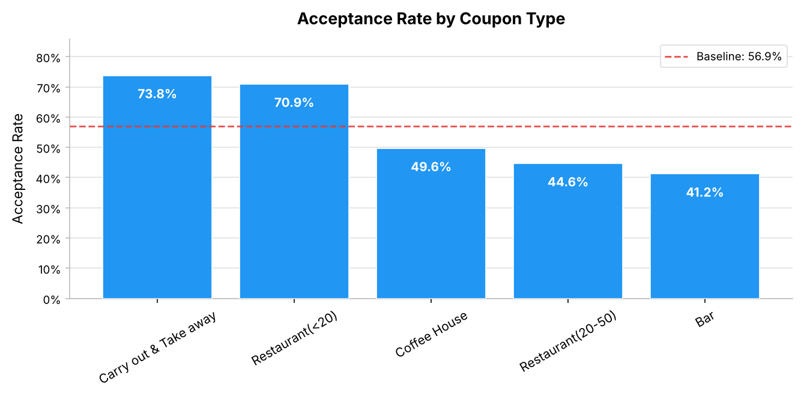
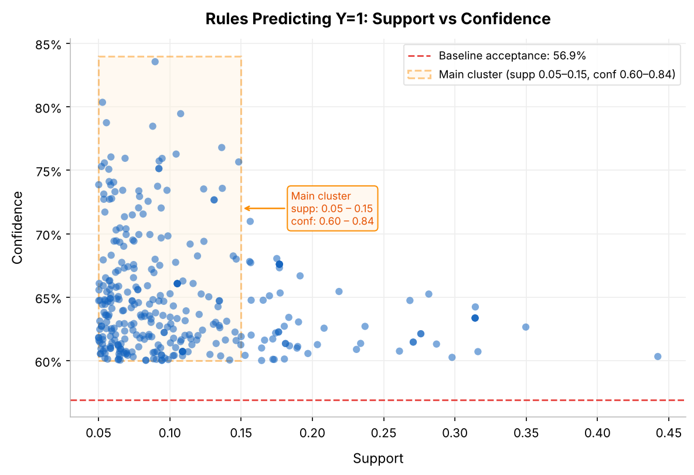

# Coupon Acceptance Rules (Apriori)

Association rule mining on 12,007 driving scenarios, to find which combinations of trip context, coupon offer and driver profile go together with drivers accepting a coupon.

**Tools:** Python, pandas, NumPy, mlxtend (Apriori), matplotlib, Jupyter\
**Notebook:** [notebooks/coupon_association_rules.ipynb](notebooks/coupon_association_rules.ipynb) ([view in nbviewer](https://nbviewer.org/github/rahat28ahmed/coupon-acceptance-association-rules/blob/main/notebooks/coupon_association_rules.ipynb))

## Key Results

- 332 rules predict acceptance on its own, and 47 of them name a coupon type. The sensitivity grid counts 352 at the same thresholds because it also keeps rules with `Y=1` plus another item on the right-hand side.
- The strongest rule: when the offer is a budget restaurant coupon (`Restaurant(<20)`) with a one-day expiry, 83.6% of drivers accept (support 0.090, lift 1.47), against 56.8% across the 12,007 mined rows.
- Budget restaurant and carry out coupons dominate the top rules. Budget restaurant coupons reach 80.4% acceptance when friends are passengers, and carry out coupons with a one-day expiry reach 78.5%.
- Taken on their own, carry out (73.8%) and budget restaurant (70.9%) coupons are accepted far more often than bar coupons (41.2%). Loose thresholds (support 0.02, confidence 0.55) give 1,245 rules; strict ones (0.08, 0.70) leave 20.

The report's recommendations, which would need testing in an A/B trial first: favour budget dining and takeaway coupons, default to a one-day expiry, and target leisure trips and groups of friends.





## Question

A coupon platform has to decide which offer to send, to whom and when. The analysis asks in which situations drivers are most likely to accept an offer, and how those patterns could guide coupon targeting.

## Data

- A module-provided version of the Coupon Recommendation dataset: 12,079 survey scenarios and 25 columns, with no missing values. It appears to derive from the UCI In-Vehicle Coupon Recommendation dataset (CC BY 4.0, Wang et al., 2017).
- Each row describes a trip (destination, passenger, weather, time), an offer (coupon type, expiry, distance, direction), the driver's profile and visit habits, and the outcome `Y` (1 = accepted).
- The data is not included here; see [data/README.md](data/README.md) for the source, licence and columns.

## Approach

1. Dropped `toCoupon_GEQ5min`, which has a single value, and 72 duplicate rows, leaving 12,007 rows. `occupation` (25 categories) was left out so it would not fragment the itemsets.
2. Calculated the overall acceptance rate and the acceptance rate for each single feature.
3. Turned each row into 23 `column=value` items and one-hot encoded them with mlxtend's `TransactionEncoder`, giving 92 distinct items.
4. Ran Apriori with a minimum support of 0.05 (itemsets of up to three items), which found 10,205 frequent itemsets, and generated 8,590 rules at a minimum confidence of 0.60.
5. Kept the rules that predict acceptance (`Y=1`), then the ones that name a coupon type, and ranked them by lift.
6. Re-ran the mining for every combination of support (0.02, 0.03, 0.05, 0.08) and confidence (0.55, 0.60, 0.65, 0.70) to see how sensitive the results are to the thresholds.

## Limitations

- The data records what drivers said they would do in survey scenarios, not coupons they actually redeemed.
- Association rules show what tends to occur together, not cause and effect.
- `direction_same` and `direction_opp` are exact opposites, so some rules appear twice in mirrored form with identical statistics.
- The thresholds were chosen by judgement from the sensitivity grid, and the rules were not checked on a hold-out sample or compared with a classifier.
- The results come from the module's pre-cleaned copy of the data. The public UCI file has more rows and missing values, so its figures would differ.

## Repository Structure

```
coupon-acceptance-association-rules/
  README.md
  requirements.txt
  LICENSE
  notebooks/coupon_association_rules.ipynb   executed analysis
  data/README.md                             how to obtain the data
  figures/                                   charts saved by the notebook
```

## How to Run

```
python -m venv .venv
source .venv/bin/activate        # Windows: .venv\Scripts\activate
pip install -r requirements.txt notebook
# place Coupon_Recommendation.csv in data/
jupyter notebook notebooks/coupon_association_rules.ipynb
```

## Context

Completed as coursework for Business Data Mining and Visual Analytics (COMP1943), MSc Business Analytics, University of Greenwich, 2025–26.
